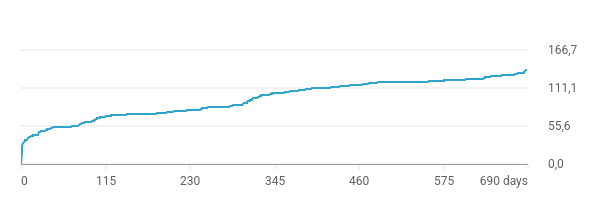

+++
title = "The STOC Video"
hasmath = false
hascode = false

date = Date(2026, 11, 02)
tags = ["blog"]

rss_title = title
rss_description = "new videooo"
rss_pubdate = date
+++

Since 2020, STOC has been asking all authors to contribute a video presentation of their paper.
This was originally a response to COVID, but it has generally been fun to get to see talks without having to travel to the conference.
The ability to experience part of the conference without the need for travel is great for many reasons, including the climate impact of heavier-than-air flight and the participatory impacts of organizing community events in far-away countries.
Even as an in-person participant I have found videos nice, either to watch back later or to watch in advance before attending the IRL talk.

Those who know my work probably know that I also enjoy *making* these videos. I put in half a week's worth of time to make a nice video, and the extra effort is appreciated by the people.
STOC 2026 was no exception on my part.
I think this is my best video yet.
I am learning how to make pretty animations and graphics, how to use the grammar of YouTube thumbnails, and I added collaborator cameos in there.

Like always: if a paper is worth the effort of reading, then it is a good look to make the video be worth watching.
Our paper this year is by far the best paper that I have ever worked on, and likely will hold that title for years to come.
It is very good work.

What is different this year is that the STOC organization didn't follow through on tradition.
For 2026 they initially told authors that there would be pre-recorded videos, but at the last moment they backed out and promised to record all talks at the conference instead.
As of today (4 months after the conference), it appears that videos from Day 1 of the event have been posted.
The remainder is nowhere to be seen.

Unwilling to wait any longer, last Monday I posted [our paper's video talk](https://www.youtube.com/watch?v=En5RPVXejqc) to my own YouTube channel.
Go watch it, it is good fun.
In this post, I will say a couple more things about the video.

## Numbers

The nice thing about this video being on my own channel, is that I can elucidate what numbers you get on a video like this.
YT's view count is very opaque to the outside observer, especially now that they inflated all measurements earlier this year.
So even though it says 2.9K views, we should *probably* not think of this as an auditorium of 2900 people.
What counts as a view requires much lower participation than sitting in a lecture room for 21 minutes.

To better estimate the effective 'audience size' compared to an in-person talk, we can use the watch time statistic instead.
At 41 hours watched and a 21:34 video runtime, that makes an 'average audience size' of 41 hours/21:34 = 114 playbacks.
In that light, we might interpret this as effectively a talk given to a 114-person audience.

Besides the total number of watch hours, YT also provides a retention that looks like this:

This indicates, for each moment in the video, something like how many viewers watched that bit of the video.
But if people slow down the video, or play back a section a second time, then it counts for more time.
I think that is why the graph isn't exactly monotonically decreasing.

If we want to count the interested audience members, we may want to count only the people who played back the entire video.
Using the retention graph, we can pretend that this represents a drop-out model and do some isotonic regression to figure out the total watchtime accounted for *by people who watched the whole video*.
With the diet problem video as a second comparison, this is the result:

I computed this graph with the retention data of the by-the-book video at 4 days since posting.
But by then it already had 38/41 watch hours, so I think the picture wouldn't change much.
Anyway, so we can see in the graph that playbacks of 90% or more of the video accounted for 54% of the total watch time.
With the 38 watch hours from a few days ago, that makes for a round 57.06 complete playbacks.
If we count each complete playback as an audience member, then that is still quite a favorable number.

For comparison we can do a similar calculation on the [diet problem video](https://www.youtube.com/watch?v=OrhiqVmsVxE).
This video has 137.5 logged watch hours as I write this.
With 64% of that being accounted for by people who watch 90% or more, that makes there are around 105 people who watched the entire video.
Or at least, 105 full playbacks of the video.

## Reach

This is good reach for the first few days.
But I think more important is the value of videos like these as a backlog.
Almost every paper I wrote has a video link attached on my website, and I believe it is links like these that drive most traffic in the long haul.

Of the 137.5 watch hours on the diet problem video, 31 were attributed to 'thumbnail impressions'.
That is, people who see the thumbnail through YouTube recommendations or search.
I think that means the remaining 106.5 hours come from direct traffic to the applicable link.
If so, that would include social media shares and links on my own website.
As we can see from the watch time graph below, there is a large early spike from social media shares.
But the vast majority of watchtime lies in the long tail that starts 7 days post-publishing and continues for years after.
See this graph with days-since-publication on the horizontal axis and total watch hours on the vertical axis:

## Interaction

These are good-sized crowds, reached from the comfort of my own home.
The [total time investment](https://www.youtube.com/watch?v=Ygu5m-yPFhg) is comparable to traveling for an invited seminar talk.
The main thing that lacks somewhat, is after-talk social interaction.
I do get emails and messages on social media from viewers sometimes, but not as many as from a normal in-person talk.
YouTube comments are mostly rude and unnecessary.
But what I do always get, is people I meet in person who tell me they watched my videos.
So the videos really are reaching the right people, and I get a chance to have more in-depth conversations in those moments.

## Conferences

This is all why I think it is so important for our community to have a tradition of video recordings.
It broadens participation, and the benefits of a video backlog are hard to overstate.

I hope that the STOC organization will post their remaining videos sometime soon, and that future conferences (all of which are in MAGA USA next year) will commit to doing videos for every paper presented.

In the meantime, if you have a nice paper but your publication venue doesn't do video:
please record a video anyway and submit it elsewhere!
In pure math there has been buzz about [some new initiative](https://www.mathematicaldiscourse.org/), but they do not consider TCS to be math.
Instead, I welcome you to submit to the [EATCS](https://www.youtube.com/@eatcs) channel.
We are open to all contributions. Shoot me or Ian Mertz a message for more information.

